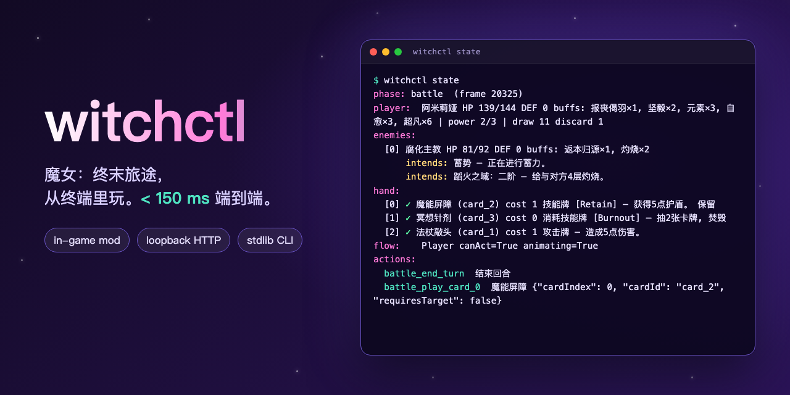

# witchctl



Drive 魔女：终末旅途 (Witch's Apocalyptic Journey, Unity/Mono) from a shell. A small mod inside the game serves a
loopback HTTP API; `witchctl` is a thin client. Built for an agent that has to answer within ~150 ms.

```
$ witchctl state
phase: battle  (frame 1995)
player:  阿米莉娅 HP 100/100 DEF 0 buffs: 元素×3 | power 3/3 | draw 4 discard 0
enemies:
  [0] 普拉提黏黏 HP 49/49 DEF 0
      intends: 蓄势 — 正在进行蓄力。
      intends: 看破 — 给与对方3层易伤。
hand:
  [0] ✓ 法杖敲头 (card_1) cost 1 攻击牌 — 造成5点伤害。
  [1] ✗ 装甲结晶 (card_6) cost 4 消耗技能牌 [Burnout] — 获得10点护盾。  (not enough power (4 > 3))
flow:    Player canAct=True animating=False
actions:
  battle_end_turn  结束回合
  battle_play_card_0  法杖敲头 {"cardIndex": 0, "cardId": "card_1", "requiresTarget": true}

$ witchctl play 0 --target 0      # validated, queued, answered at once
$ witchctl end-turn
$ witchctl wait --phase rewards --wait-timeout 30
```

## Commands

| command | what it does |
|---|---|
| `ping` | is the bridge up |
| `state [--full]` | phase, open windows, legal actions; in battle player/enemies (with intents)/hand/flow; on reward screens the rewards/cards; for unmodelled phases the UI. `--full` (with `--json`) adds the raw config rows behind each card |
| `actions` | just the legal actions |
| `act ID` | perform a legal action (`main_menu_start_game`, `map_continue`, `dialogue_advance`, `battle_end_turn`, `reward_claim_N`, `card_choice_pick_N`, …) |
| `play N\|--uid UID [--target E] [--wait]` | play a hand card. Hand indices shift as cards leave the hand; `uid` does not. `--target` is an enemy `index` (default: the first living enemy). Default answers when queued, the outcome lands in `flow.lastPlay`; `--wait` answers after it resolved (hundreds of ms) |
| `end-turn` | end the player's turn |
| `ui` / `click ID\|LABEL\|--path P` | active windows' clickables and texts / click one |
| `wait [--phase P] [--action A] [--text T] [--idle]` | poll until true; exit 1 on timeout |
| `audio on\|off` | global mute switch |
| `raw METHOD PATH [JSON]` | anything else, e.g. `raw GET /debug`, or `raw GET '/world?root=Breaks&depth=5'` (world objects of a scene that is not a window) |

Global flags work before or after the subcommand: `--json`, `--timing` (wall/hop/exec ms on stderr), `--port`, `--timeout`.
Exit codes: `0` ok · `1` the game refused / condition not met / timeout · `2` bridge unreachable or bad usage.

Phases: `main_menu house hub game_entry map_select dialogue battle battle_won battle_lost rewards card_choice blessing_choice rest event run_end slot unknown`.
The game's own phase model stops at `battle`; everything after a won fight is modelled here (`mod/Screens.cs`):

| phase | actions |
|---|---|
| `battle_won` | `battle_open_rewards` (the game usually opens the chest by itself) |
| `rewards` | `reward_claim_N` (money, a card to choose, a blessing), `reward_close` |
| `card_choice` | `card_choice_pick_N`, `card_choice_skip` — `cardChoice` lists name, cost and text |
| `blessing_choice` | `blessing_pick_N` |
| `battle_lost` | none; `ui` is attached |

Other screens (shop, skill tree) are `unknown`/`map_select` with the UI dump: `windows` in the state names what is open
(a shop or skill tree opened over the map still reports `map_select`), `click ExitButton` leaves it. `unknown` also appears for a
moment during scene changes: retry rather than fail (`wait`).

Scene-changing actions (`main_menu_start_game`, `game_entry_start`, `map_continue`, `house_open_game_menu`) fire **once**: the game keeps
offering them while the scene loads, and a second `map_continue` starts a second fight on top of the first (no player, no hand). The bridge
refuses a repeat for 10 s or until the phase changes; poll with `wait` instead of repeating.

Every sixth map the route is built by hand: `route:` lists the empty/filled frames, `tray` the cards, and `map_place_N` puts card N into
the first empty frame (like dropping a dragged card); `map_continue` appears once every frame is filled.

The rest room (a world scene, not a window; `windows` is empty there) is phase `rest`: `rest:` shows HP and the food on the table,
`rest_eat_N` eats one (the food is renumbered afterwards), `rest_leave` takes the arrow to the next node of the route.

Story events (`EventUI`) are phase `event`: `event:` shows title, full text and the options (disabled ones marked), `event_option_N` chooses
one. A choice makes the game swap the options for a single "结束事件" button, which is then the only action (`resolved`).

The settlement screen at the end of a run (`GameExitUI`) is phase `run_end`: `run end:` gives cleared/lost and the score breakdown, and
`run_end_continue` is clicked twice (first shows the breakdown, then claims the reward and leaves for the hub).

Chaos Paradise (`mode_choice_slot`, player level 25+) is phase `slot`: `slot:` shows the chips, the draws and what leaving now pays in truth;
`slot_end_run` opens the game's own "end this run?" window, `modal_confirm_end_run` answers it, and the usual `run_end` screen follows. `examples/greedy.py --mode slot`
does the whole cycle (about 23 s per run). Difficulty tags raise what it pays and are saved in the profile: see CLAUDE.md trap 37.

The first-run tutorial shows as `tutorial: <speaker> (slide/slides): <text>` over any phase; `tutorial_advance` clicks through it (it is
listed first among the actions while a tip is up).

`map_continue` only appears once the map is ready (the game needs a few seconds after the scene change to fill in its nodes); until
then `note` in the state says why. In `card_choice` the `note` explains a full card collection, when the game refuses every pick and
only `card_choice_skip` is left.

`canAct` is false while cards are still being dealt, while a card asks for a choice and while the end-turn button is hidden. A fight can
be scripted (`flow.fake`): the player is then revived at full HP instead of losing.

## Example agent

`examples/greedy.py` plays whatever phase the game is in, using only the CLI: menus, dialogue, fights, rewards, card
and blessing choices, and leaves unmodelled screens through their exit button. Fights: free draws and kills first, block when the announced
(or last turn's) damage would leave it under half health, attacks by damage per energy otherwise. Events and the route lean towards reward
and risk (a coin flip for a relic over 30 gold; the hardest fights, then the shop, the rest room last), cards are picked by rarity. One life
per run. It is a smoke test and a template built on plain heuristics, not a strong player.

```
examples/greedy.py --fights 2       # stop on the map after winning two fights
```

## Latency (Apple silicon, game hidden in the background)

| | p50 | p99 |
|---|---|---|
| bridge round trip (HTTP) for `state`/`actions`/`ui` | ~6 ms | ~16 ms |
| whole `witchctl` process incl. interpreter start | ~42 ms | ~50–70 ms |

Worst-case hop to the Unity main thread is one frame. What is *not* covered by the budget: the game's own work. Resolving a
card takes 240–460 ms on the main thread, `main_menu_start_game` ~700 ms (scene load), and the game has multi-second
loading hitches shortly after launch. That is why `play` acknowledges instead of waiting.

## Development (macOS)

The repo lives in `~/Codes/witchctl` (moved there from a volatile `/tmp` prototype).

Needs the game installed through Steam, a .NET SDK (`scripts/bootstrap-dotnet.sh` installs one into `.toolchain/`).
The lab never touches the Steam install (the mod is installed into the real copy separately, below).

```
scripts/lab.sh clone      # APFS clone of the game into .lab/ with its own bundle id (own saves and prefs)
scripts/lab.sh install    # build + copy the mod in
scripts/lab.sh start      # hidden, no focus steal, muted; returns when the game answers fast
python3 -I -m unittest discover -s tests -t . -p 'test_cli.py'                       # unit
WITCHCTL_E2E_PLAY=1 python3 -I -m unittest discover -s tests -t . -p 'test_live.py'  # live (fresh profile: lab.sh reset)
scripts/lab.sh stop
```

Installing the mod into the real game: copy `build/WitchCtl.local.dll` to `<App>/Contents/Mods/WitchCtl/Scripts/Entry.dll`
with `mod/ModConfig.json` and `mod/Icon.png` next to it (Windows: `<Game>_Data/Mods/WitchCtl/`, untested). Set
`WITCHCTL_MUTE=1` for silence, `WITCHCTL_PORT` to move the port. Do not run it in multiplayer.

A whole run in the real Steam game (done 2026-10-19, 奈奈 doom-power build, see `CLAUDE.md` trap 39): start the game through Steam (`open -g steam://rungameid/3709430`; Steam passes no environment,
so mute with `witchctl audio off`), `witchctl act main_menu_start_game`, then `LOG=… WITCHCTL_PROFILE=<real SaveData.sav> scripts/nana/run.sh`. A saved run in `SaveData/Saves/` turns Start into the continue/new-game
window: move it aside first. To go back to the vanilla game, delete `<App>/Contents/Mods/WitchCtl`.
